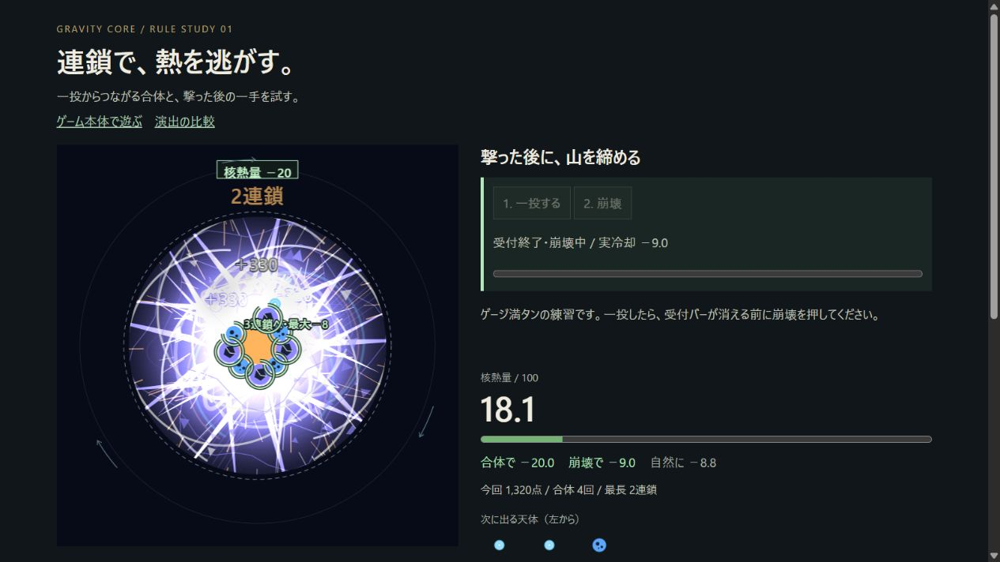

# rules.html 初見実操作審査 — 2026-10-26

対象: http://127.0.0.1:5173/dev/rules.html

ブラウザID2に自分で新規作成した専用タブだけを使用。連鎖、崩壊（時間切れ・成功）、成長（重ね表示あり・なし）、自由プレイ（クリック投入・ドラッグ投入・一時停止／再開）を実操作した。コード、作り手の外部説明、過去の評価は読んでいない。表示領域は約1265×712。音はON操作まで確認したが、実聴できないため未確認。動画は収録せず、経過画面を写真で保存した。対象のコードは変更していない。専用タブは作成時のハンドルで閉じた。

## 欠点10個（重い順）

★は、初見の人へこの練習画面を見せる前に直すべきもの。

1. **★ 崩壊練習で、失敗の方が得に見える**
   どこが：時間切れは3,900点・合体8回・核熱量0.0、崩壊成功は1,320点・合体4回・核熱量0.0で終わった。
   なぜ駄目か：表示された成果だけでは「崩壊を押さずに待つ方がよい」と学んでしまい、成功メッセージと判断材料が食い違う。
   どう直すか：同じ盤面の使用／未使用を並べ、崩壊で避けられる危険や配置改善を明示し、成功した方の利点が結果画面に必ず残る練習条件にする。

2. **★ 自然冷却が、教えたい合体冷却を上回る**
   どこが：連鎖結果は合体−7.0に対して自然−10.6、成長結果は合体−2.0に対して自然−9.4だった。
   なぜ駄目か：「連鎖で熱を逃がす」という題に対し、最も効いた行動が時間経過になり、狙って合体させる価値が伝わらない。
   どう直すか：ルールを覚える間は自然冷却を止めるか固定し、合体直前→直後の温度差を主表示にしてから、通常時間のルールへ進ませる。

3. **★ 崩壊の初回受付が約1秒しかない**
   どこが：「1. 一投する」を押した直後、別ボタンの「2. 崩壊」に残り約1.0秒の受付が出る。初回は時間切れになった。
   なぜ駄目か：初見は飛んだ天体を見るため、説明とボタンと盤面を見比べる余裕がない。ルール理解より先に反射操作を要求している。
   どう直すか：初回は受付開始で停止し、崩壊ボタンを押したら進行する。次の段階で数秒の猶予、最後に通常の制限時間へ縮める。

4. **成長予告が、次の判断へつながらない**
   どこが：赤い予告は「限界外」、実結果は「限界内」。結果説明は「静止時の目安で、動いた位置とは異なる」にとどまる。
   なぜ駄目か：どの天体がどちらへ押され、何が予告との差を生んだかを自分で解読する必要があり、予告を信用してよい場面が分からない。
   どう直すか：対象天体を一つずつ強調し、元位置→押す方向→成長後の位置を短い段階再生にする。予告の不確かさも画面上に範囲として示す。

5. **★ 計算途中の桁が結果表示へ漏れる**
   どこが：崩壊時間切れ後の履歴に「3連鎖 / 合体冷却 -2.8333333333332997 / +960点」が表示された。
   なぜ駄目か：画面全体が未確認の試作品に見え、温度や冷却量の表示を信頼しにくくする。長い数値は他の情報も押しのける。
   どう直すか：履歴、盤面上の表示、内訳を同じ桁数と符号表記へ統一し、表示用の丸めを全経路で適用する。

6. **通常の表示領域で練習操作が画面外へ落ちる**
   どこが：1265×712では成長結果や崩壊結果の説明が増えると、練習切替・自由プレイ・音・停止操作が下へ隠れる。
   なぜ駄目か：盤面を見たまま次の操作を探せず、スクロールで盤面と操作部の往復が必要になる。
   どう直すか：見出しの高さを抑え、必須操作を盤面に近い固定領域へまとめる。内訳や長文の比較説明は必要な時に展開する。

7. **崩壊中に、何が合体したか見えなくなる**
   どこが：白紫の放射線と発光が盤面を覆い、複数の「+330」、連鎖表示、冷却表示が中心付近で重なる。
   なぜ駄目か：派手さを追う間に原因となった天体を見失い、「自分の一手でどこが変わったか」が読み取れない。
   どう直すか：合体する2個と生まれる1個を先に見せ、光はその背後へ抑える。得点は一か所へ集約し、冷却と連鎖を時間差で表示する。

8. **同じ天体を探すには、序盤の絵が小さすぎる**
   どこが：広い円形盤面の中心に小さい青系・紫系の天体が密集し、次の天体も小さい図形だけで並んでいる。
   なぜ駄目か：色や細かい模様を見比べる必要があるのに、同種の判別と成長順の把握が一瞬でできず、狙いを立てにくい。
   どう直すか：序盤の最小表示サイズを上げ、色以外の輪郭・記号も区別する。常時見える短い進化順の図と、次の天体の名前を付ける。

9. **自由プレイへの操作の橋渡しが薄い**
   どこが：成長練習は「この照準で撃つ」の固定操作で終わり、自由プレイでは突然「引いて離すと曲げて投げます」の一文になる。
   なぜ駄目か：ドラッグの向きと距離が初速や曲がり方へどう効くかを練習しておらず、2回ドラッグしても狙った合体へつなげる基準を得られなかった。
   どう直すか：短いドラッグと長いドラッグを同じ位置から試す一問を挟み、入力矢印と実際の軌跡を残して比較できるようにする。

10. **自由プレイで、すぐ最初から試し直す操作が見当たらない**
    どこが：自由プレイの操作部はモード切替と一時停止／再開が中心で、明示的な「最初から」「盤面を戻す」がない。
    なぜ駄目か：投げ方の違いを同じ条件で比べたい時、別モードへ移るか選択中のモードを押し直すのかを推測しなければならない。
    どう直すか：自由プレイに「盤面をリセット」を常設し、同じ初期配置と次の天体で即座に試し直せるようにする。

## 比較する実在作品

この形式で一番よい比較対象として、私なら **[スイカゲーム ぷらねっと](https://suikagame.jp/planet/)** を選ぶ。中心へ落とす円形ステージと同種合体が直接近い。今回、公式サイトの盤面紹介を確認した。

比べて足りないのは、天体の種類・進化順・落とす方向・盤面の危険を、一枚の盤面から読み取れる視覚整理。
もう一つは、投入→接触→合体→次の狙いの因果を途切れさせない演出で、この画面は説明文と冷却数値の解読が間に入る。

## AIが作った画面・動きに見えるか

**見える。** 実際の制作方法を断定する意味ではなく、実操作した時の印象。そう感じる箇所が多かった順に挙げる。

1. **説明と計測情報の積み重ね**：全モードの文章、温度、内訳、点、合体回数、連鎖、履歴が似た重さで並び、体験を絞らず要求項目を順に足した画面に見える。
2. **汎用的な図形の反復**：核・天体・軌道が円と線と模様を中心に構成され、天体ごとの役割を形で設計した意図より、素早く用意した仮の部品に見える。
3. **演出の足し算**：崩壊時の発光、放射線、粒子、得点、連鎖、冷却表示が同時に主張し、見せたい一つの出来事を決めず効果を重ねたように見える。
4. **説明と結果の整合が弱い**：連鎖より自然冷却が強い、崩壊の失敗でも熱0、限界外予告でも限界内結果という箇所があり、個別機能を足して全体の学習体験を通していないように見える。
5. **未整形の数値**：合体冷却の長い小数がそのまま出て、表示の最後の確認まで人の目が通っていないように見える。

## 確認資料

- [01 連鎖の結果](rules-firstlook-20261026-01-chain.jpg)：2連鎖、合体−7.0、自然−10.6。
- [02 崩壊の時間切れ](rules-firstlook-20261026-02-collapse-timeout.jpg)：失敗で熱0、3,900点、長い小数を含む履歴。
- [03 崩壊の成功結果](rules-firstlook-20261026-03-collapse.jpg)：成功側の結果。
- [04 成長前](rules-firstlook-20261026-04-growth-before.jpg)：赤い限界予告。
- [05 成長後](rules-firstlook-20261026-05-growth-after.jpg)：予告と実結果の重ね表示、合体−2.0、自然−9.4。
- [06 自由プレイ](rules-firstlook-20261026-06-free-play.jpg)：420点、合体3回、核熱量・冷却とも0、操作部と内訳。
- [07 崩壊中](rules-firstlook-20261026-07-collapse-motion.jpg)：光・得点・連鎖・天体が重なる瞬間。
- [08 比較作品の公式紹介](rules-firstlook-20261026-08-reference.jpg)：スイカゲーム ぷらねっとの盤面、ネクスト、進化順の表示。

