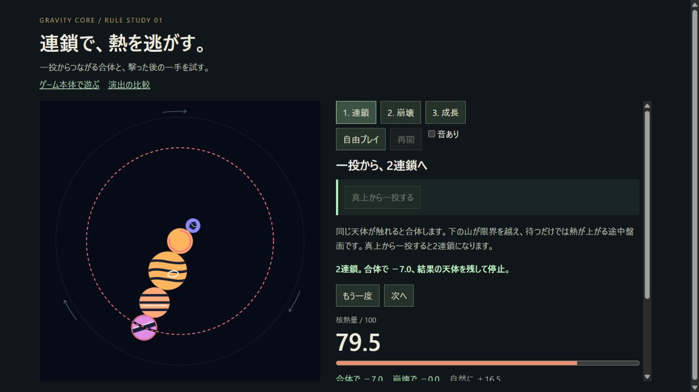
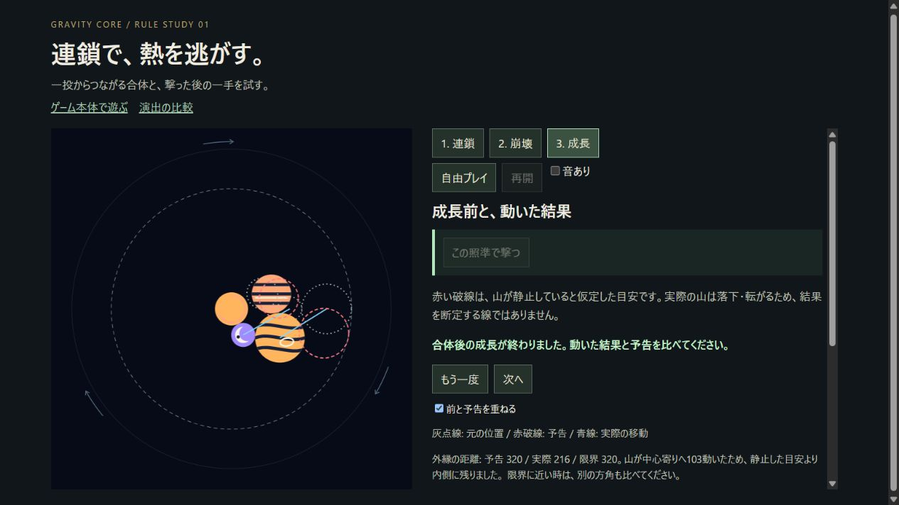
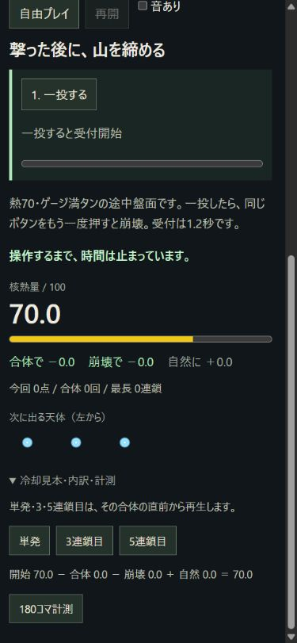

対象：http://127.0.0.1:5173/dev/rules.html
確認日：2026-10-26

作り手の説明・過去の審査・実装ソースを読まず、画面内の文言だけを手掛かりに実操作した審査。コード変更なし。
通常幅1266×712とスマホ相当390×844で、連鎖成功、崩壊成功と時間切れ、成長、自由プレイのクリック・ドラッグを確認した。スマホ実機のタッチ操作は未確認。音は実聴できず未確認。

★は直すまで人に見せられないと判断した項目。重い順。

1. ★どこが：連鎖練習の成功結果。開始70.0から、2連鎖成功後に79.5へ上がる（合体−7.0／自然＋16.5）。  
なぜ駄目か：「連鎖で、熱を逃がす。」という主題なのに、指定どおり成功した一投で危険が増し、最初に覚える因果関係が逆になる。  
どう直すか：最初の教材を連鎖の総収支で熱が下がる盤面・速度にし、成功した瞬間に開始値との差を盤面横へ示す。

2. ★どこが：崩壊練習から自由プレイへ移った後の操作欄。崩壊ボタン、充填状態、実行方法の案内が見当たらない。  
なぜ駄目か：練習では「同じボタンをもう一度」と教えたのに、そのボタンが消えるため、覚えた救済操作を自由プレイへ持ち込めない。  
どう直すか：自由プレイにも同じ位置・名前の崩壊操作と常設ゲージを置き、使用可能・不足・受付中を盤面と同時に示す。

3. ★どこが：390×844の縦配置。盤面は上、熱量・次の天体・結果は下に離れ、「次へ」でもスクロール位置が残る。  
なぜ駄目か：投げる場所を見ている間に危険度と次の手が見えず、次の教材では盤面や予告の上部が画面外になっている。  
どう直すか：盤面、熱、次の天体、主操作を一画面へ収め、教材移動時は盤面と主操作が見える位置へ揃える。

4. ★どこが：すでに選択中の「自由プレイ」ボタン。再押下で盤面と次の天体が説明なく初期化される。  
なぜ駄目か：モード名の再選択に見える操作で進行を失う。「やり直し」と読める表示もなく、操作結果を予測できない。  
どう直すか：選択中のモード押下は進行を保ち、初期化は独立した「最初から」に明示する。

5. どこが：天体の種類と成長順の提示。次の3個は小さな絵だけで、全体の成長順や合体先が示されない。  
なぜ駄目か：初見では縞模様・色・大きさの何が同種判定なのか、何を作ればよいのかが分からず、合体を先読みできない。  
どう直すか：盤面を見たまま参照できる成長順の図を置き、次の天体と合体候補・合体先を同じ記号で対応させる。

6. どこが：成長結果の「別の方角も比べてください」という案内と、固定の「この照準で撃つ」ボタン。盤面の別方角を押す・ドラッグする操作でも照準は変わらなかった。  
なぜ駄目か：比較を求めるのに比較する入力が見つからず、危険な成長を避ける判断を練習できない。  
どう直すか：方角を選び直せる照準操作を用意し、同じ初期盤面で方角ごとの予告と実際を比較させる。

7. どこが：核熱量と盤面の危険表示。「自然に＋／−」の収支は出るが、増減の条件・速度と100に達した場合の説明がない。  
なぜ駄目か：下の山が限界を越えている説明だけでは、どの箇所をどれだけ直せば安全になるかが判断できず、数字の変化を眺めるだけになる。  
どう直すか：限界を越えた天体を盤面で強調し、現在の熱変化速度、危険に至る条件、回復する操作を短く対応表示する。

8. どこが：通常幅の右側の独立スクロール欄。ページ全体にもスクロールがあり、教材切替後も欄の途中位置が残る。  
なぜ駄目か：見出し・発射ボタン・熱量・次の天体が同じ欄の中で隠れ合い、どこをスクロールすれば次の操作が見つかるかが分かりにくい。  
どう直すか：遊ぶための主情報を固定した小さなパネルへ集約し、履歴と計測だけを別の折り畳み領域へ移す。

9. どこが：連鎖結果の冷却表記。成功文と合計欄は「合体で−7.0」、直近イベントは「2連鎖／合体冷却−5.0」。  
なぜ駄目か：合計とその合体1回分の区別が文言から読み取れず、2連鎖の冷却値が二通りあるように見える。  
どう直すか：「今回の合計−7」「2回目の合体−5」のように対象範囲を明記し、1回目から足し上がる順で表示する。

10. どこが：崩壊の時間切れと成功の結果表示。両方とも淡い緑の文章と同じ「もう一度／次へ」で返される。  
なぜ駄目か：1.2秒の受付を逃した失敗が見た目で際立たず、盤面の何を見て次はいつ押すべきかという訂正につながらない。  
どう直すか：受付開始を盤面上で予告し、成功は締まった山と冷却、失敗は消えた受付と再入力の時機を、それぞれ短い専用演出で示す。

比較基準に一つ選ぶ作品：[スイカゲーム ぷらねっと](https://suikagame.jp/planet/)。公式紹介でも、惑星へ360°から投下して同種を成長させる仕組みが示されている。
それと比べて、成長の順序・狙う対象・危険の前兆を、説明文へ降りずに盤面を見て読める視覚的な整理が足りない。  
また、投下から成長、危険の回避、成功・失敗の手応えまでを、同じ操作と一つの画面で学べる一貫性が足りない。

AIが作った物に見えるか：見える。制作手段の断定ではなく、画面と操作から受けた印象。強くそう感じさせた順に5つ。

1. どこが：モード、再生、音、内訳、計測が四角い汎用フォームとして並ぶ所。なぜそう見えるか：遊びの優先順位より、実装できた項目を順に配置した検証ページの構成に見える。
2. どこが：「熱を逃がす」の成功で熱が上がり、「別の方角を比べる」に方角変更がない所。なぜそう見えるか：文章と実際の挙動が別々に作られ、プレイヤーの一続きの体験として照合されていない印象になる。
3. どこが：「予告320／実際216／限界320」「中心寄りへ103」といった成長結果の説明。なぜそう見えるか：単位やプレイヤーの判断との接続がない内部的な数値を、長い文章で説明して埋めたように見える。
4. どこが：天体が色違いの円と縞模様で増える一方、成長順・個性・役割の対応が見えない所。なぜそう見えるか：規則的に生成した素材が並び、遊びに必要な識別性を人が詰め切っていない印象になる。
5. どこが：成功・時間切れ・停止が主に文章の差し替えで示される所。なぜそう見えるか：状態分岐は実装されていても、その出来事の重さに応じた画面と動きの演出が薄く、機械的な状態表示に見える。

確認画像（代表3枚）

連鎖成功後の熱量79.5：

成長結果の固定照準・予告・説明の配置：

スマホ幅で「次へ」の直後、盤面が見えない崩壊練習：

終了処理：viewportの一時変更はresetして1266×712へ復帰。作成した専用タブだけを閉じた。親のタブには操作していない。
